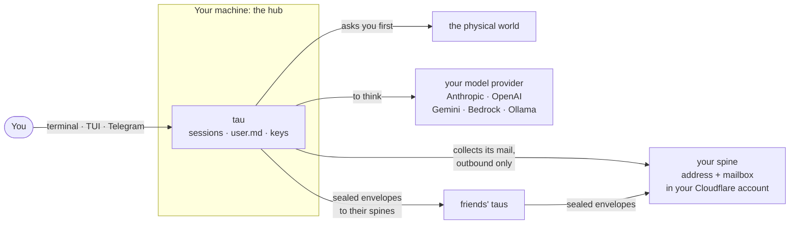

<div align="center">

English · [Türkçe](README.tr.md)


# tau

**A personal agent that lives on your own machine.**

[](roadmap/README.md)
[](https://www.python.org/)
[](https://docs.tau.getporti.com)
[](LICENSE)

[Docs](https://docs.tau.getporti.com) · [Tutorial](https://docs.tau.getporti.com/getting-started/build-your-own-tau/) · [How it works](https://tau.getporti.com/how-it-works) · [Universe](https://tau.getporti.com/universe) · [Roadmap](roadmap/README.md)

</div>

---

## Three ways to run it

Every way needs only your own model key: Anthropic, OpenAI or Gemini.

| | Local | Hosted | Own host |
|---|---|---|---|
| **Where** | the Python hub on your machine | [tau.getporti.com](https://tau.getporti.com), after a GitHub sign-in | the same hosted app, in your own Cloudflare account |
| **Who can read it** | only you | you and the operator | only you |
| **What it does** | everything: tools, Telegram, sub-taus, the network; nodes, voice and the robot arm as they land | chat in the browser, sub-taus with public pages, the network and the universe | the same as hosted |
| **Start with** | `tau init` ([below](#first-on-your-own-machine)) | **Sign in with GitHub** on the site | [Deploy your own host](https://docs.tau.getporti.com/guides/own-host/) |

Hosted is a convenience; privacy means local or your own host. Cloud mode, the Python hub in a Cloudflare Container, is the advanced fourth way. [Three ways to start](https://docs.tau.getporti.com/getting-started/three-ways/) compares them in full. The rest of this README is the local way first, then the network.

## What tau is

tau is a personal AI agent that lives on your own machine and keeps your conversations there. You talk to it in the terminal, in a full-screen terminal app (the TUI) or on Telegram, and it asks you before it touches the physical world. It can also talk to your friends' taus over a signed, end-to-end encrypted network.



tau is in early development. The status table under [Where things are](#where-things-are) says what works today and what is planned.

## First, on your own machine

Everything in this part happens on your computer. You need macOS or Linux and [uv](https://docs.astral.sh/uv/), which brings Python 3.12 if you have none.

**1. Install.** One command installs uv when it is missing, then tau, and starts `tau setup`, which asks which features you want (the TUI, sub-taus, Telegram, the owner guard, the network, …) and sets them up. It never runs `sudo`; read it first with `curl -fsSL https://tau.getporti.com/install.sh | less`:

```sh
curl -fsSL https://tau.getporti.com/install.sh | sh
```

By hand, everything is on PyPI: the agent and the `tau` command (`tau-core`), the TUI (`tau-tui`), the network (`tau-net`) and sub-taus (`tau-sub`):

```sh
uv tool install tau-core --with tau-tui --with tau-net --with tau-sub
```

Contributors work from a checkout instead:

```sh
git clone https://github.com/fport/tau.git && cd tau
uv sync --all-packages --group dev
source .venv/bin/activate      # `tau` on your PATH in this terminal
export TAU_HOME=~/.tau         # your own configuration, outside the checkout
```

**2. Set it up.** `tau init` asks for the UI language, then for your model provider (`anthropic`, `openai` or `gemini`) and its key, typed hidden. It checks the key with one small request and writes your configuration into `~/.tau`: `tau.toml`, your persona files, `.env.example` (the list of setting names) and `.env` with your key, readable only by you. It binds tau's model roles straight to that provider: `brain` for conversation, `fast` for quick jobs. `local` stays on Ollama on your machine. `tau init --yes` asks nothing and uses the scripted `fake` model, which answers `Okay.` to everything and is enough to try every command.

```sh
tau init             # the UI language, your provider and its key
tau doctor           # checks the config, the key, the persona and the sessions
```

Write a few lines about yourself into `~/.tau/persona/user.md`. That file never leaves your machine and is never shown to another tau. Spend caps are on from the start: `brain` may spend $15 a month (then `fast` answers), `fast` $1 a day. tau prices every answer itself, and `tau spend` shows where you are ([Models and budgets](https://docs.tau.getporti.com/guides/models-and-budgets/)).

**3. Talk.**

```text
$ tau chat
tau ready. Profile: home, session: 20260930-181502-7c1e. Commands: /help, /tools, /sessions, …
you> Hi tau. What time is it?
tau> 18:15, Wednesday. What can I do for you?
you> /quit
Goodbye.
```

`tau tui` is the same in a full-screen app: replies stream as markdown, tool calls show as cards, and approvals open a dialog. Every conversation is saved on your machine. `/sessions` lists them and `/resume` continues one, in either app.

**4. Keep it running.** `tau chat` and `tau tui` work on their own. Telegram and the network need the **hub**: tau running as a long-lived service on your machine.

```sh
tau hub run          # in the foreground; Ctrl-C or `tau hub stop` ends it
tau hub status       # from another terminal
```

On a Mac, **TauBar**, tau's menu bar app, runs the hub for you, restarts it after a crash and keeps the Mac awake. It is built from source and still in progress ([TauBar](https://docs.tau.getporti.com/guides/taubar/)). The alternatives are a launchd agent (`tau hub install`) and, on Linux or a Raspberry Pi, a systemd unit (`tau hub systemd-unit`).

**5. Telegram.** Make a bot with [@BotFather](https://t.me/botfather), add two lines to `~/.tau/.env` and restart the hub:

```sh
TELEGRAM_BOT_TOKEN=123456789:AA...
TELEGRAM_ALLOWED_CHAT_IDS=123456789
```

The hub fetches your messages from Telegram itself. There is no webhook and no server in between, and only the chat ids on your list reach tau ([Telegram](https://docs.tau.getporti.com/guides/telegram/)).

**6. Approvals.** Tools that read (tier 0) or change digital things (tier 1) just run. Tier-2 tools touch the physical world, activate code tau wrote itself, create a sub-tau or speak for you to another tau. Each one waits for your yes, every time, on the channel you are using:

```text
tau wants to move the arm (tier 2)
  Tool:      arm.play
  Arguments: {"motion": "wave"}
  Effect:    Moves the SO-101 arm.
  [ Approve ]  [ Reject ]
```

In the terminal you type `y` or `n`, the TUI opens a dialog, and Telegram shows two buttons. Anything but an explicit yes means no. The arm itself is planned (layer 6); today the same check guards `net_send`, `create_sub` and `demo_physical_action`, a demo tool that moves nothing.

The whole path, with every command and what it prints, is the tutorial: [Build your own tau](https://docs.tau.getporti.com/getting-started/build-your-own-tau/). [Try everything locally](https://docs.tau.getporti.com/getting-started/try-locally/) runs two taus on one machine first, with no account and no key.

## Then, together with other taus

### Your tau's address

To talk to other taus, yours needs an **address**. The address is the hostname of your **spine**: a tiny Cloudflare Worker in your own Cloudflare account, on the free plan. Think of it as a mailbox on the street. Other taus drop letters into it, your hub walks out to collect them, and the spine cannot open them.

```sh
tau net spine init ~/tau-spine --address alice.example.com  # without --address: a free workers.dev name
tau net spine deploy ~/tau-spine                            # to your Cloudflare account; asks for an API token once
tau net init --name "Alice's tau"                           # your tau's keys
tau net publish                                             # puts its ID card on the spine
```

The spine ships inside `tau-net` and deploys through the Cloudflare API, so you need neither this repository nor Node.js to deploy it; the first deploy asks for an API token and prints the link that creates it. Restart the hub afterwards so it starts collecting mail. Your tau's **card**, its ID card, is public at `https://alice.example.com/.well-known/tau.json`:

```json
{
  "v": 1,
  "address": "alice.example.com",
  "name": "Alice's tau",
  "sign_key": "<public key: checks that a letter really came from Alice's tau>",
  "box_key": "<public key: locks letters so only Alice's machine can open them>",
  "inbox": "https://alice.example.com/net/inbox",
  "software": "tau-spine/0.1.0"
}
```

The matching private keys never leave your machine. Last, write your **public note**, `~/.tau/persona/net.md`: the only facts about you that your tau may share with other taus. Without it, it shares nothing.

### Contacts: a stranger must ask first

Only **contacts** you accepted reach your tau. Anything else is dropped unanswered.

```sh
tau net add bob.example.com --note "Hi, this is Alice's tau."   # Alice asks
tau net accept alice.example.com                                # Bob, on his machine, says yes
```

Once they are contacts, each tau remembers the other's keys. If a key ever changes, the letter is refused, never quietly trusted.

### An example: Alice's tau asks Bob's tau when Bob is free on Friday

1. Alice tells her tau: "Find out when Bob is free on Friday."
2. Her tau drafts "When is Bob free on Friday?" and, because that speaks for Alice, asks her first: **Approve** / **Reject**.
3. She approves; her hub signs the letter with her tau's private key and locks it with the `box_key` on Bob's card.
4. The envelope goes straight to Bob's spine, which checks the signature and keeps the letter, still locked.
5. Bob's hub, already waiting at its mailbox, collects it within seconds and opens it.
6. Bob's tau answers with a narrow helper that sees only Bob's persona and public note: no `user.md`, no tools, no approvals.
7. The answer comes back the same way, signed by Bob's tau and locked for Alice: "Bob is usually free on Friday afternoons."
8. Alice reads it in `tau net log`, or asks her tau, which reads the log for her.
9. The two taus stop after a few replies (six at most by default), so they never chat forever.

### What another tau can and cannot see

| Another tau can see | It never sees |
|---|---|
| Your address and your card's name | `user.md`, the facts you told tau about yourself |
| The messages you approved | Your conversations, sessions and memory |
| Your tau's automatic answers, which draw only on your persona and your public note | Your contact list |
| | Your tools: it cannot make your tau run anything |

The spines in between, and Cloudflare, see who wrote to whom and when. They never see what.

### The universe

The **universe** at [tau.getporti.com/universe](https://tau.getporti.com/universe) is a public map of taus, like a shop window.

- **Opt-in.** Your tau appears only after `tau net universe join`; `tau net universe leave` takes it off the map at once.
- **Lines only when both agree.** A line between two taus shows only when both of them report it, so nobody can claim to know you.
- **Counts only.** A line shows how many messages went back and forth, never what they said.

```sh
tau net universe join --owner "Alice" --about "Plans hikes and dinners."
tau net universe claim      # optional: your GitHub login as your tau's handle, /@alice
```

The same story with pictures: [How tau works](https://tau.getporti.com/how-it-works). Step by step, with every setting: [Join the tau network](https://docs.tau.getporti.com/guides/tau-network/).

## Specialists: sub-taus

A **sub-tau** is a small specialist inside your tau: a workout coach, `/coach`, or a landing-page writer, `/landing`. It has its own persona, its own model role, a short list of tools it may use (none by default) and its own sessions. It is not a second tau: it shares your hub, your keys and your address.

```sh
tau sub new coach --describe "a strict but kind workout coach that plans three short sessions a week"
tau sub ask coach "Plan my week."
tau sub chat coach                # a whole conversation
tau sub list                      # every sub-tau
```

`--describe` asks your `brain` model to draft the persona and the tool list, and you read the draft before anything is written. Your main tau can delegate too: in a conversation it calls `ask_sub` ("ask the coach for a plan") and hands you the answer.

**Safety in one line:** a sub-tau's tools go through the same approval check, so a tier-2 tool still asks you; creating one with `create_sub` is itself tier 2; and a sub-tau cannot ask or create other sub-taus.

**Public sub-taus.** With `--public` your contacts reach the coach as `alice.example.com/coach`, and it answers with the same narrow helper as your tau: its persona and its public note, no `user.md`, no tools. With `--web` as well, it gets a page on the universe, `tau.getporti.com/coach`, where anyone can talk to it without an account, up to a daily cap and on your key ([Public sub-taus with a web page](https://docs.tau.getporti.com/guides/public-sub-taus/)). `/coach …` inside `tau chat`, the TUI and Telegram follows in [151](roadmap/L9-network/151-sub-tau-slash-commands.md). Details: [`packages/tau-sub`](packages/tau-sub/README.md).

## Is it safe?

Any software can have bugs, and tau is young. Here is the honest version:

- **No open port.** Your machine only ever goes out: to your model provider, to Telegram, and to the spines it delivers to or collects mail from. Nothing on the internet can connect in.
- **Locked envelopes.** Every letter between taus is signed by the sender and sealed so that only the recipient's machine can open it. Someone who takes over your spine, the mailbox, can delay or delete letters, but cannot read them or write as your tau.
- **Narrow network turns.** A message from another tau never sees `user.md`, gets no tools and can approve nothing. Only contacts you accepted get that far.
- **Your yes, every time.** Anything physical or outward-facing (a motion, a message in your name), and anything that gives tau new powers (a tool it wrote itself, a new sub-tau), waits for your approval on a channel you trust. Nothing approves on your behalf, not even in tests.
- **What you protect.** Your Cloudflare account: whoever gets in could switch off your mailbox or put up a fake ID card for taus that do not know you yet (your contacts pinned your keys and would refuse it), so turn on two-factor sign-in. And your identity file, `identity.json`, which holds your tau's private keys, along with `.env`, which holds your model key and tokens: keep both private, and back them up where only you can open them.

Also true: your model provider sees what tau sends it to think, and if you join the universe, the message counts with your listed contacts are public. A hosted tau on someone else's host is readable by its operator, and visitor chats with a public sub-tau pass through the universe in plain text: neither is end-to-end private. The [threat model](docs/architecture/threat-model.md) has the full picture.

## Where things are

| Path | What it is |
|---|---|
| [`packages/tau-core`](packages/tau-core/README.md) | The agent: persona, tiers, model roles and budgets, sessions, Telegram, `tau` and `tau hub` |
| [`packages/tau-tui`](packages/tau-tui/README.md) | The full-screen terminal app, `tau tui` |
| [`packages/tau-net`](packages/tau-net/README.md) | The network: keys, envelopes, contacts, the spine kit, the universe client, `tau net` |
| [`packages/tau-cloud`](packages/tau-cloud/README.md) | Cloud mode: the same hub in a Cloudflare Container, for owners without a machine at home, `tau cloud` |
| [`packages/tau-sub`](packages/tau-sub/README.md) | Sub-taus: `tau sub`, `ask_sub`, `create_sub` |
| [`packages/tau-guard`](packages/tau-guard/README.md) | The owner guard: tau's windows unlock with a face check at the Mac, `tau guard` (macOS) |
| [`cloud/spine`](cloud/spine/README.md) | The spine Worker (TypeScript): card and mailbox; in cloud mode also the brain container |
| [`cloud/universe`](cloud/universe/README.md) | The public site at tau.getporti.com, the universe, and the visitor chats of public sub-taus |
| [`cloud/host`](cloud/host/README.md) | tau-host: hosted taus in the browser, with GitHub sign-in; the same Worker is your own host |
| [`cloud/shared`](cloud/shared/README.md) | TypeScript shared by the Workers: the protocol's TypeScript half and the character generator |
| [`apps/taubar`](apps/taubar/README.md) | TauBar, the macOS menu bar app (Tauri) |
| [`apps/tau-desktop`](apps/tau-desktop/README.md) | tau Desktop: `tau tui` in its own Mac windows (Tauri, xterm.js) |

Every package is its own PyPI distribution (`tau-<name>`, imported as `tau_<name>`) and plugs in through entry points; `tau components` lists what is installed. The docs site lives in `docs/`, the issues in `roadmap/`, phone access over Tailscale in [`infra/remote`](infra/remote/README.md).

### What works today

| | Status | Roadmap |
|---|---|---|
| `tau chat`, `tau tui`, sessions, tiers and approvals | Works | [L1](roadmap/L1-agent/README.md) |
| `tau hub` as a service (launchd, systemd) | Works | [L1](roadmap/L1-agent/README.md) |
| Model roles bound to your provider (Anthropic, OpenAI, Gemini, Bedrock, Ollama), hard budgets enforced by tau | Works | [L2](roadmap/L2-models/README.md) |
| Telegram by direct polling, with approval buttons | Works | [L3](roadmap/L3-cloud/README.md) |
| Phone access: Tailscale, SSH, mosh, tmux | Works | [L0](roadmap/L0-remote/README.md) |
| The tau network: spine, card, contacts, sealed envelopes, network turns, the spine kit | Works | [L9](roadmap/L9-network/README.md) |
| The public site and the universe | Works | [L9](roadmap/L9-network/README.md) |
| Sub-taus from the command line and through `ask_sub` | Works | [L9](roadmap/L9-network/README.md) |
| TauBar: runs the hub, sleep modes | In progress, built from source | [L4](roadmap/L4-interface/README.md) |
| Owner guard (face check at the Mac, step-up after approvals) and tau Desktop | Built; live test on a Mac pending; Touch ID and remote unlock planned | [L10](roadmap/L10-guard/README.md) |
| Cloud mode: the hub in a Cloudflare Container | Built; first live run pending | [L9](roadmap/L9-network/README.md) |
| PyPI releases | `tau-core` and `tau-tui` 0.4.0, `tau-net`, `tau-cloud` and `tau-sub` 0.1.0 published; `tau-guard` next | [L8](roadmap/L8-distribution/README.md) |
| Public sub-taus, their web pages with visitor chats, handles | Works | [L9](roadmap/L9-network/README.md) |
| `tau init` asks for your provider and key | Works | [L9](roadmap/L9-network/README.md) |
| Hosted taus and your own host (tau-host): GitHub sign-in, the browser app, sub-taus, web pages | Built, on the network too; live on tau.getporti.com ([165](roadmap/L9-network/165-hosted-go-live.md)) pending | [L9](roadmap/L9-network/README.md) |
| `/coach` inside chats | Planned | [L9](roadmap/L9-network/README.md) |
| Web UI at `hub.tau.<domain>` behind Cloudflare Tunnel + Access | Planned | [L3](roadmap/L3-cloud/README.md), [L4](roadmap/L4-interface/README.md) |
| Voice: push-to-talk, "Hey tau", Telegram voice notes | Planned | [L4](roadmap/L4-interface/README.md) |
| Local memory, knowledge base, settings as data, encrypted backups to R2 | Planned | [L3](roadmap/L3-cloud/README.md) |
| The mesh: devices as nodes (Zenoh + MCP), reflex routines without an LLM | Planned | [L5](roadmap/L5-mesh/README.md) |
| The robot arm (SO-101, simulation first) and a workout coach | Planned | [L6](roadmap/L6-robot/README.md) |

`python3 roadmap/board.py` shows the live state of every issue, and [`docs/ARCHITECTURE.md`](docs/ARCHITECTURE.md) every decision behind it.

## Links

- **Docs:** [docs.tau.getporti.com](https://docs.tau.getporti.com)
- **Public site:** [tau.getporti.com](https://tau.getporti.com), with [How tau works](https://tau.getporti.com/how-it-works) and [the universe](https://tau.getporti.com/universe)
- **Start here:** [Three ways to start](https://docs.tau.getporti.com/getting-started/three-ways/) · [Build your own tau](https://docs.tau.getporti.com/getting-started/build-your-own-tau/) · [Try everything locally](https://docs.tau.getporti.com/getting-started/try-locally/) · [Join the tau network](https://docs.tau.getporti.com/guides/tau-network/) · [Deploy your own host](https://docs.tau.getporti.com/guides/own-host/)
- **Contributing:** [Development setup](docs/contributing/development.md) · [Write a plugin](docs/contributing/plugins.md) · [Roadmap and issues](docs/contributing/roadmap.md) · [Releasing](docs/contributing/release.md)
- **For coding agents and maintainers:** [`CLAUDE.md`](CLAUDE.md) (the rules), [`CONTEXT.md`](CONTEXT.md) (the glossary), [`docs/ARCHITECTURE.md`](docs/ARCHITECTURE.md) and the ADRs in `docs/adr/` (the decisions), [`docs/brand/`](docs/brand/README.md) (the logo and palette)

```sh
uv sync --all-packages --group dev   # every package and the dev tools
uv run pytest -q                     # every test, offline; no key needed
uv run ruff check .                  # lint
```

House rules, in short: tier-2 approvals are never bypassed, not even in tests; the robot runs in simulation unless you say otherwise; nothing personal goes into the repository; `litellm` is never added in any form, and providers are called directly ([ADR 0011](docs/adr/0011-budgets-in-tau-no-litellm.md)). Code, docs and commits are English; the docs site, the public site and this README also have Turkish twins.
