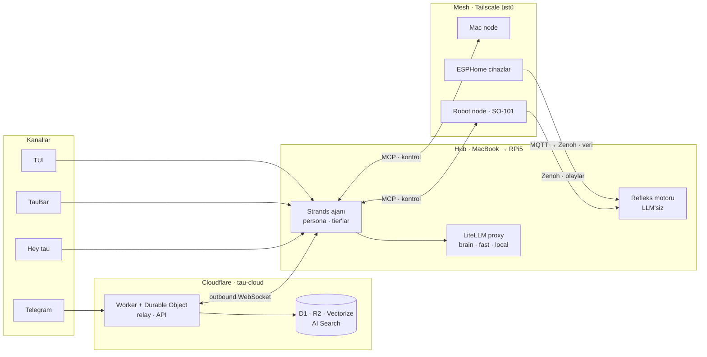

<div align="center">


# tau

**Kişisel "akıllı body".** Telegram'dan, terminalden ve sesle konuşulan; robot kol, kolye kamera ve ev sensörleriyle fiziksel dünyaya dokunan bir ajan platformu.

[](roadmap/README.md)
[](https://www.python.org/)
[](https://docs.astral.sh/uv/)
[](https://pnpm.io/)
[](https://www.conventionalcommits.org/)

[](https://strandsagents.com/)
[](https://modelcontextprotocol.io/)
[](https://zenoh.io/)
[](https://workers.cloudflare.com/)
[](https://tailscale.com/)
[](https://tauri.app/)

[Mimari](docs/ARCHITECTURE.md) · [Yol haritası](roadmap/README.md) · [Sözlük](CONTEXT.md) · [Marka](docs/brand/README.md) · [Uzaktan erişim](infra/remote/README.md) · [Ajan talimatları](CLAUDE.md)

</div>

---

## tau nedir?

tau'nun beyni bir **hub**'da çalışır. Hub bugün MacBook, RPi5 gelince o olacak. tau'yla Telegram'dan, terminalden, menü çubuğundaki TauBar'dan ya da "Hey tau" diye seslenerek konuşursun. Cihazlara **node**'lar üzerinden ulaşır, durumunu Cloudflare'de tutar.

- **Konuşur:** Telegram, terminal arayüzü (TUI), TauBar, sesle "Hey tau", Claude Code için MCP server.
- **Dokunur:** SO-101 robot kol, kolye kamera, ESP32 sensörler. Fiziksel dünyaya dokunan her eylem senin onayından geçer.
- **Hatırlar:** Her oturum kaydedilir ve `/devam` ile sürer. Hafıza ve bilgi tabanı Self-RAG döngüsüyle aranır.
- **Refleksleri var:** Rutinler ve güvenlik durdurmaları LLM'siz ve buluta bağlı olmadan çalışır.
- **Bütçelidir:** Her model rolünün sert bir harcama limiti var, limit dolunca tau kontrollü şekilde geri çekilir.

## Mimari



- **Kontrol düzlemi MCP, veri düzlemi Zenoh.** Hub, node'ların yeteneklerini MCP ile çağırır. Olaylar ve telemetri Zenoh üzerinden akar.
- **Hub buluta sadece `tau-cloud` Worker'ı üzerinden gider.** D1, R2 ve Vectorize'a doğrudan bağlanmaz. Ham telemetri D1'e hiç girmez.
- **Kod model adı istemez, rol ister.** `brain`, `fast` ve `local` rolleri LiteLLM proxy'de sağlayıcıya bağlanır: Bedrock, yedek olarak Anthropic, yerelde Ollama.

Kararların tamamı ve gerekçeleri [`docs/ARCHITECTURE.md`](docs/ARCHITECTURE.md)'de.

## İlkeler

1. **Beyin bulutta düşünür, refleksler yerelde çalışır.** Duruş uyarısı, ev kuralları ve acil durdurma hiçbir zaman LLM'e ya da Cloudflare'e bağlı olmaz.
2. **Aynı kod her makinede çalışır.** Makineler arasındaki tek fark rol: `TAU_ROLE=hub|node`. Aynı anda tek bir hub aktif olur.
3. **Ayarlar veridir, kod değil.** D1'deki `settings` tablosundan gelir, hub bunları deploy gerektirmeden canlı yükler.
4. **Fiziksel dünyaya ya da kendi koduna dokunan her şey onaylıdır.** Bunlar tier 2 eylemler.
5. **Donanım yoksa kod da yok.** Elde olmayan cihaz için mesh'te sadece yer ayrılır.

## Monorepo

Bu repo merkez. İçindeki her şey, ileride yayınlanabilecek ya da ayrı bir repoya taşınabilecek şekilde kuruluyor.

| Yol | Tür | Dağıtım · import | Görevi | Durum |
|---|---|---|---|---|
| `packages/tau-core` | Python | `tau-core` · `tau_core` | `build_agent`, persona, tier'lar, roller, oturumlar, `tau` CLI, `tau hub` | [#004](roadmap/L1-agent/004-tau-chat-tracer-bullet.md) ile başlıyor |
| `packages/tau-tui` | Python | `tau-tui` · `tau_tui` | Textual ile sohbet ve canlı olay paneli | [#008](roadmap/L1-agent/008-textual-tui.md) |
| `packages/tau-mesh` | Python | `tau-mesh` · `tau_mesh` | Zenoh, MCP yetenek keşfi, MQTT köprüsü | [#032](roadmap/L5-mesh/032-zenoh-router-and-liveliness.md) |
| `packages/tau-robot` | Python | `tau-robot` · `tau_robot` | SO-101 node; strands-robots, önce simülasyon | [#039](roadmap/L6-robot/039-so101-sim-node.md) |
| `packages/tau-vision` | Python | `tau-vision` · `tau_vision` | Spor koçu: pose ile form takibi | [#043](roadmap/L6-robot/043-workout-coach-webcam.md) |
| `apps/taubar` | Tauri v2 · React/TS | — | Tray uygulaması: uyku modları, durum, onaylar, ses | [#024](roadmap/L4-interface/024-taubar-sleep-modes.md) |
| `cloud/tau-cloud` | TypeScript | — | Worker: relay, D1, R2, Vectorize, AI Search, Whisper | [#014](roadmap/L3-cloud/014-telegram-relay-tracer-bullet.md) |
| `infra/litellm` | Docker | — | Model proxy'si; image digest ile pinli | [#010](roadmap/L2-models/010-litellm-proxy-roles.md) |
| [`infra/remote`](infra/remote/README.md) | shell | — | Telefondan uzaktan erişim: Tailscale, SSH, mosh, tmux | ✅ kullanımda |

**Kurallar**

- `packages/` altındaki her paket bağımsız bir PyPI dağıtımı. Adı `tau-<ad>`, import adı düz `tau_<ad>`. `tau` namespace paketi kullanılmıyor, çünkü `tau`, `tau-hub` ve `tau-agent` isimleri PyPI'de dolu.
- Her paketin kendi `pyproject.toml`'u, sürümü, README'si ve testleri var. Paketler birbirine sadece public API ve bildirilmiş bağımlılıklar üzerinden bağlanır: path hack yok, private import yok.
- Genişletme entry point'lerle yapılır. Şimdilik `tau.tools`, ileride `tau.nodes` ve `tau.channels` gelecek. Başka bir repoda geliştirilen paket buraya dokunmadan, `pip install` ile takılır.
- Kendi sürüm döngüsü, firmware'i ya da katkıcıları olan paket kendi reposuna taşınır. tau onu PyPI'den kullanmaya devam eder, entry point sözleşmesi değişmez.
- Python 3.12+ ve uv workspace kullanılıyor. TypeScript tarafları (`cloud/`, `apps/`) pnpm ile yönetiliyor.

## Yol haritası

tau katman katman kuruluyor. Bir katman tek başına işe yarar hale gelmeden sonrakine geçilmiyor.

| | Katman | Kapsam | Durum |
|---|---|---|---|
| 0 | [Uzaktan erişim](roadmap/L0-remote/README.md) | Telefon → Tailscale → mosh → tmux → Claude Code | ✅ kullanımda |
| 1 | [Ajan](roadmap/L1-agent/README.md) | Strands çekirdeği, persona, tier'lar, oturumlar, TUI, hub servisi | sırada |
| 2 | [Modeller](roadmap/L2-models/README.md) | LiteLLM proxy, rol yönlendirme, sert bütçeler | planlandı |
| 3 | [Bulut](roadmap/L3-cloud/README.md) | Telegram relay, oturum kaydı, ayarlar, hafıza ve bilgi tabanı | planlandı |
| 4 | [Arayüz](roadmap/L4-interface/README.md) | TauBar, sesli mesaj, Claude Code entegrasyonu, ambient mod, Hey tau | planlandı |
| 5 | [Mesh](roadmap/L5-mesh/README.md) | Zenoh + MCP node'lar, MQTT köprüsü, refleks rutinleri | planlandı |
| 6 | [Robot](roadmap/L6-robot/README.md) | SO-101 ve spor koçu | planlandı |
| 7 | [Deney alanı](roadmap/L7-lab/README.md) | AgentCore, otonom görev kuyruğu | planlandı |

Her iş `roadmap/` altında ayrı bir markdown dosyası. Güncel durum için:

```sh
python3 roadmap/board.py           # her şey, katmanlara göre
python3 roadmap/board.py --next    # bir ajanın şimdi alabileceği işler
python3 roadmap/board.py --human   # senin karar ya da iş vermen gerekenler
```

## Başlarken

Bugün çalışan kısım katman 0: telefondan Mac'teki Claude Code'a kesintisiz erişim.

```sh
cp .env.example .env               # yerel değerler; .env hiçbir zaman commit'lenmez
infra/remote/setup.sh              # tmux, mosh ve kabuk ayarları (sudo'suz)
infra/remote/setup-sudo.sh         # Tailscale, sshd sertleştirmesi, Remote Login
infra/remote/doctor.sh             # zincirin tamamını kontrol eder
```

Ayrıntılar [`infra/remote/README.md`](infra/remote/README.md)'de. İlk ajan dilimiyle ([#004](roadmap/L1-agent/004-tau-chat-tracer-bullet.md)) birlikte `uv run tau chat` geliyor.

## Güvenlik

- **Tier'lar:** Tier 0 okuma işleridir ve serbesttir. Tier 1 dijital yazma işleridir, serbesttir ama loglanır. Tier 2 fiziksel eylemler ve tau'nun kendi yazdığı tool'lardır, her seferinde onay ister. Onay testlerde bile atlanmaz.
- **Robot:** Varsayılan mod simülasyon. Gerçek donanım sadece açıkça istendiğinde hareket eder.
- **Sırlar ve kişisel veriler:** Sırlar yerel `.env` dosyasında ve `wrangler secret`'ta durur. Repoya kişisel değer girmez, dosyalarda sadece örnek değerler bulunur.
- **Tedarik zinciri:** `litellm` Python bağımlılığı olarak eklenmez. Proxy, digest ile pinlenmiş bir container olarak çalışır.

## Çalışma şekli

- Issue'lar [`roadmap/`](roadmap/README.md)'de. Akış şöyle: `ready-for-agent` → `in-progress` → `done`. Her iş, sonuna tarihli bir notla kapanır.
- Commit'ler [Conventional Commits](https://www.conventionalcommits.org/) biçiminde ve İngilizce yazılır: `type(scope): özet`.
- Dil kuralı: Kod, commit ve issue'lar İngilizce. Mimari dokümanı ve tau'nun kullanıcıya gösterdiği çıktılar Türkçe.
- Bu repoda çalışan kodlama ajanları için kurallar [`CLAUDE.md`](CLAUDE.md)'de, terimler [`CONTEXT.md`](CONTEXT.md)'de.
