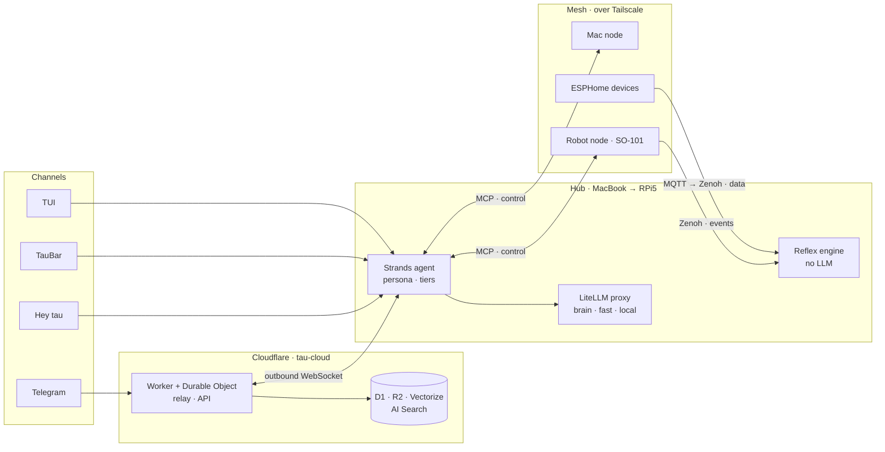

<div align="center">


# tau

**A personal "smart body".** An agent platform you talk to from Telegram, the terminal and by voice, and that touches the physical world through a robot arm, a necklace camera and home sensors.

[](roadmap/README.md)
[](https://www.python.org/)
[](https://docs.astral.sh/uv/)
[](https://pnpm.io/)
[](https://www.conventionalcommits.org/)

[](https://strandsagents.com/)
[](https://modelcontextprotocol.io/)
[](https://zenoh.io/)
[](https://workers.cloudflare.com/)
[](https://tailscale.com/)
[](https://tauri.app/)

[Architecture](docs/ARCHITECTURE.md) · [Roadmap](roadmap/README.md) · [Glossary](CONTEXT.md) · [Brand](docs/brand/README.md) · [Remote access](infra/remote/README.md) · [Agent instructions](CLAUDE.md)

</div>

---

## What is tau?

tau's brain runs on a **hub**. Today the hub is a MacBook; when the RPi5 arrives, it moves there. You talk to tau from Telegram, from the terminal, from TauBar in the menu bar, or by saying "Hey tau". It reaches devices through **nodes** and keeps its state in Cloudflare.

- **Talks:** Telegram, a terminal UI (TUI), TauBar, "Hey tau" by voice, and an MCP server for Claude Code.
- **Touches:** the SO-101 robot arm, a necklace camera, ESP32 sensors. Every action that touches the physical world goes through your approval.
- **Remembers:** every session is recorded and continues with `/resume`. Memory and the knowledge base are searched with a Self-RAG loop.
- **Has reflexes:** routines and safety stops run without an LLM and without the cloud.
- **Is budgeted:** every model role has a hard spend cap; when it is hit, tau backs off in a controlled way.

## Architecture



- **Control plane is MCP, data plane is Zenoh.** The hub calls node capabilities over MCP. Events and telemetry flow over Zenoh.
- **The hub reaches the cloud only through the `tau-cloud` Worker.** It never connects to D1, R2 or Vectorize directly. Raw telemetry never enters D1.
- **Code asks for a role, not a model name.** The `brain`, `fast` and `local` roles are bound to providers in the LiteLLM proxy: Bedrock, Anthropic as the fallback, Ollama locally.

Every decision and its reasoning is in [`docs/ARCHITECTURE.md`](docs/ARCHITECTURE.md).

## Principles

1. **The brain thinks in the cloud, reflexes run locally.** Posture alerts, house rules and the emergency stop never depend on an LLM or on Cloudflare.
2. **The same code runs on every machine.** The only difference between machines is the role: `TAU_ROLE=hub|node`. Only one hub is active at a time.
3. **Settings are data, not code.** They come from the `settings` table in D1 and the hub hot-reloads them without a deploy.
4. **Everything that touches the physical world or tau's own code needs approval.** Those are tier-2 actions.
5. **No hardware, no code.** A device that is not on hand only gets a reserved place in the mesh.

## Monorepo

This repo is the centre. Everything in it is built so it can be published, or moved to its own repo, later.

| Path | Kind | Distribution · import | Job | Status |
|---|---|---|---|---|
| `packages/tau-core` | Python | `tau-core` · `tau_core` | `build_agent`, persona, tiers, roles, sessions, the `tau` CLI, `tau hub` | started with [#004](roadmap/L1-agent/004-tau-chat-tracer-bullet.md), L1 done |
| `packages/tau-tui` | Python | `tau-tui` · `tau_tui` | Chat and a live event pane with Textual | [#008](roadmap/L1-agent/008-textual-tui.md) |
| `packages/tau-mesh` | Python | `tau-mesh` · `tau_mesh` | Zenoh, MCP capability discovery, MQTT bridge | [#032](roadmap/L5-mesh/032-zenoh-router-and-liveliness.md) |
| `packages/tau-robot` | Python | `tau-robot` · `tau_robot` | SO-101 node; strands-robots, simulation first | [#039](roadmap/L6-robot/039-so101-sim-node.md) |
| `packages/tau-vision` | Python | `tau-vision` · `tau_vision` | Workout coach: form tracking with pose estimation | [#043](roadmap/L6-robot/043-workout-coach-webcam.md) |
| `apps/taubar` | Tauri v2 · React/TS | — | Tray app: sleep modes, status, approvals, voice | [#024](roadmap/L4-interface/024-taubar-sleep-modes.md) |
| `cloud/tau-cloud` | TypeScript | — | Worker: relay, D1, R2, Vectorize, AI Search, Whisper | [#014](roadmap/L3-cloud/014-telegram-relay-tracer-bullet.md) |
| `infra/litellm` | Docker | — | Model proxy; image pinned by digest | [#010](roadmap/L2-models/010-litellm-proxy-roles.md) |
| [`infra/remote`](infra/remote/README.md) | shell | — | Remote access from the phone: Tailscale, SSH, mosh, tmux | ✅ in use |

**Rules**

- Every package under `packages/` is an independent PyPI distribution. Its name is `tau-<name>`, its import name the flat `tau_<name>`. There is no `tau` namespace package, because `tau`, `tau-hub` and `tau-agent` are taken on PyPI.
- Every package has its own `pyproject.toml`, version, README and tests. Packages depend on each other only through public APIs and declared dependencies: no path hacks, no private imports.
- Extension goes through entry points: `tau.tools`, `tau.commands`, `tau.providers`, `tau.sessions`, `tau.context` and `tau.hub_services` today; `tau.nodes` and `tau.channels` later. A package developed in another repo plugs in with `pip install`, without touching this one.
- A package that needs its own release cadence, firmware or contributors moves to its own repo. tau keeps consuming it from PyPI and the entry-point contract does not change.
- Python 3.12+ with a uv workspace. The TypeScript parts (`cloud/`, `apps/`) are managed with pnpm.

## Roadmap

tau is built layer by layer. The next layer starts only when the previous one is useful on its own.

| | Layer | Scope | Status |
|---|---|---|---|
| 0 | [Remote access](roadmap/L0-remote/README.md) | Phone → Tailscale → mosh → tmux → Claude Code | ✅ in use |
| 1 | [Agent](roadmap/L1-agent/README.md) | Strands core, persona, tiers, sessions, TUI, hub service | ✅ done |
| 2 | [Models](roadmap/L2-models/README.md) | LiteLLM proxy, role routing, hard budgets | planned |
| 3 | [Cloud](roadmap/L3-cloud/README.md) | Telegram relay, session recording, settings, memory and knowledge base | planned |
| 4 | [Interface](roadmap/L4-interface/README.md) | TauBar, voice notes, Claude Code integration, ambient mode, Hey tau | planned |
| 5 | [Mesh](roadmap/L5-mesh/README.md) | Zenoh + MCP nodes, MQTT bridge, reflex routines | planned |
| 6 | [Robot](roadmap/L6-robot/README.md) | SO-101 and the workout coach | planned |
| 7 | [Lab](roadmap/L7-lab/README.md) | AgentCore, autonomous task queue | planned |

7 of 61 issues are done. Every piece of work is a separate markdown file under `roadmap/`. For the current state:

```sh
python3 roadmap/board.py           # everything, grouped by layer
python3 roadmap/board.py --next    # what an agent can pick up now
python3 roadmap/board.py --human   # what needs your decision or your hands
```

## Getting started

Layer 0 works today: uninterrupted access from the phone to Claude Code on the Mac.

```sh
cp .env.example .env               # local values; .env is never committed
infra/remote/setup.sh              # tmux, mosh and shell setup (no sudo)
infra/remote/setup-sudo.sh         # Tailscale, sshd hardening, Remote Login
infra/remote/doctor.sh             # checks the whole chain
```

Details are in [`infra/remote/README.md`](infra/remote/README.md).

Layer 1, the agent, runs in the terminal:

```sh
uv sync --all-packages --group dev # Python 3.12 environment and every package
uv run tau init                    # write tau.toml and persona/user.md from the templates
uv run tau doctor                  # config, credentials, session store, persona files
uv run tau chat                    # talk to tau in the terminal
uv run tau tui                     # the Textual UI
uv run tau components              # every registered tool, provider, backend and service
uv run pytest -q                   # tests; no credentials needed
```

Which role uses which model lives in `tau.toml`; credentials live in `.env` (names in `.env.example`). If a variable is missing, `tau chat` says which one and exits. The UI language is `[ui] language` in `tau.toml` (`en` by default, `tr` available), overridable with `TAU_LANG`, `tau --lang tr ...` or `/lang` inside a session.

## Safety

- **Tiers:** Tier 0 is reading and runs freely. Tier 1 is digital writing; it runs freely but is logged. Tier 2 is physical actions and tools tau wrote itself; it asks for approval every time. Approval is never skipped, not even in tests.
- **Robot:** the default mode is simulation. Real hardware moves only when explicitly asked.
- **Secrets and personal data:** secrets stay in the local `.env` and in `wrangler secret`. No personal values enter the repo; tracked files hold example values only.
- **Supply chain:** `litellm` is never added as a Python dependency. The proxy runs as a container pinned by digest.

## How work happens

- Issues live in [`roadmap/`](roadmap/README.md). The flow is `ready-for-agent` → `in-progress` → `done`. Every issue closes with a dated note at the end.
- Commits follow [Conventional Commits](https://www.conventionalcommits.org/) and are written in English: `type(scope): summary`.
- Language rule: everything in the repo is English (code, comments, docs, issues, commits). tau's persona is Turkish by default and answers in whichever language the user writes; the UI chrome follows the `[ui] language` setting.
- The rules for coding agents working in this repo are in [`CLAUDE.md`](CLAUDE.md), the terms in [`CONTEXT.md`](CONTEXT.md).
