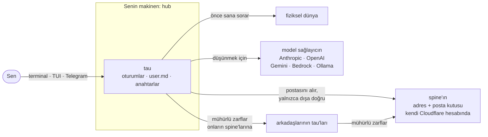

<!-- tr twin of README.md, translated 2026-09-30 -->

<div align="center">

[English](README.md) · Türkçe


# tau

**Kendi makinende yaşayan kişisel bir ajan.**

[](roadmap/README.md)
[](https://www.python.org/)
[](https://docs.tau.getporti.com/tr/)
[](LICENSE)

[Dokümanlar](https://docs.tau.getporti.com/tr/) · [İndir](https://tau.getporti.com/tr/download) · [Kendi tau'nu kur](https://docs.tau.getporti.com/tr/getting-started/build-your-own-tau/) · [Nasıl çalışır](https://tau.getporti.com/tr/how-it-works) · [Evren](https://tau.getporti.com/tr/universe) · [Yol haritası](roadmap/README.md)

</div>

---

## Çalıştırmanın üç yolu

Her yol için yalnızca kendi model anahtarın yeter: Anthropic, OpenAI ya da Gemini.

| | Yerel | Barındırılan | Kendi kurulumun |
|---|---|---|---|
| **Nerede** | kendi makinende, Python hub'ında | [tau.getporti.com](https://tau.getporti.com/tr/) üzerinde, GitHub ile girişten sonra | aynı barındırılan uygulama, kendi Cloudflare hesabında |
| **Kim okuyabilir** | yalnızca sen | sen ve işletmeci | yalnızca sen |
| **Ne yapar** | her şeyi: araçlar, Telegram, sub-tau'lar, ağ; geldikçe node'lar, ses ve robot kol | tarayıcıda sohbet, açık sayfalı sub-tau'lar, ağ ve evren | barındırılanla aynı |
| **Nasıl başlanır** | `tau init` ([aşağıda](#önce-kendi-makinende)) | sitede **GitHub ile giriş yap** | [Kendi kurulumunu yap](https://docs.tau.getporti.com/tr/guides/own-host/) |

Barındırılan bir kolaylıktır; gizlilik, yerel ya da kendi kurulumun demektir. Python hub'ını bir Cloudflare Container'ında çalıştıran bulut modu ise ileri düzey dördüncü yoldur. [Başlamanın üç yolu](https://docs.tau.getporti.com/tr/getting-started/three-ways/) hepsini ayrıntısıyla karşılaştırıyor. Bu README'nin geri kalanı önce yerel yolu, sonra ağı anlatıyor.

## tau nedir

tau, kendi makinende yaşayan ve konuşmalarını orada tutan kişisel bir yapay zekâ ajanı. Onunla terminalde, tam ekran bir terminal uygulamasında (TUI) ya da Telegram'da konuşursun; fiziksel dünyaya dokunmadan önce de mutlaka sana sorar. Ayrıca arkadaşlarının tau'larıyla, imzalı ve uçtan uca şifreli bir ağ üzerinden konuşabilir.



tau henüz erken geliştirme aşamasında. Bugün neyin çalıştığını, neyin planlandığını [Neler nerede](#neler-nerede) bölümündeki durum tablosu gösteriyor.

## Önce kendi makinende

Bu bölümdeki her şey kendi bilgisayarında olur. macOS ya da Linux yeterli; kurucu [uv](https://docs.astral.sh/uv/)'yi getirir, Python 3.12 yoksa uv onu da getirir.

**1. Kur.** Tek bir komut, yoksa önce uv'yi, sonra tau'yu kurar ve `tau setup`'ı başlatır; o da hangi özellikleri istediğini sorar (TUI, sub-tau'lar, Telegram, sahip koruması, ağ, …) ve onları ayarlar. Hiçbir zaman `sudo` çalıştırmaz; önce `curl -fsSL https://tau.getporti.com/install.sh | less` ile okuyabilirsin:

```sh
curl -fsSL https://tau.getporti.com/install.sh | sh
```

Mac'te bunun yerine [uygulamayı indirebilirsin](https://tau.getporti.com/tr/download): macOS 13 ve sonrası için, Apple silicon ve Intel'de çalışan `tau.dmg`. Menü çubuğuna bir **τ** koyar, hub'ı çalıştırır, sohbet pencereleri açar ve ilk açılışında aynı kurulumu bir sihirbaz olarak yürütür. Apple'ın noter onayından henüz geçmedi; bu yüzden macOS onu açmadan önce bir kez sorar. İndirme sayfası nasıl izin vereceğini gösterir.

Elle kurmak istersen hepsi PyPI'da: ajan ve `tau` komutu (`tau-core`), TUI (`tau-tui`), ağ (`tau-net`) ve sub-tau'lar (`tau-sub`):

```sh
uv tool install tau-core --with tau-tui --with tau-net --with tau-sub
```

Katkıda bulunanlar bunun yerine depodan çalışır. Son iki satır `tau`'yu bu terminalde PATH'e ekler ve yapılandırmanı depodan ayrı, kendi klasöründe tutar:

```sh
git clone https://github.com/fport/tau.git && cd tau
uv sync --all-packages --group dev
source .venv/bin/activate      # `tau` on your PATH in this terminal
export TAU_HOME=~/.tau         # your own configuration, outside the checkout
```

**2. Ayarla.** `tau init` önce arayüz dilini, sonra model sağlayıcını (`anthropic`, `openai` ya da `gemini`) ve onun anahtarını sorar; anahtar yazılırken görünmez. Anahtarı küçük bir istekle dener ve yapılandırmanı `~/.tau` içine yazar: `tau.toml`, persona dosyaların, ayar adlarının listesi olan `.env.example` ve anahtarınla birlikte yalnızca senin okuyabildiğin `.env`. tau'nun model rollerini doğrudan o sağlayıcıya bağlar: sohbet için `brain`, hızlı işler için `fast`. `local` ise kendi makinendeki Ollama'da kalır. `tau init --yes` hiçbir şey sormaz ve senaryolu `fake` modeli kullanır; bu model her şeye `Okay.` der ve bütün komutları denemek için yeterlidir.

```sh
tau init             # the UI language, your provider and its key
tau doctor           # checks the config, the key, the persona and the sessions
```

`tau doctor` yapılandırmayı, anahtarı, persona dosyalarını ve oturum deposunu kontrol eder. Ardından `~/.tau/persona/user.md` dosyasına kendinle ilgili birkaç satır yaz. Bu dosya makinenden hiç çıkmaz ve başka bir tau'ya asla gösterilmez. Harcama sınırları baştan açık: `brain` ayda 15 dolar harcayabilir (sonra `fast` yanıt verir), `fast` ise günde 1 dolar. tau her yanıtın fiyatını kendisi hesaplar; nerede olduğunu `tau spend` gösterir ([Modeller ve bütçeler](https://docs.tau.getporti.com/tr/guides/models-and-budgets/)).

**3. Konuş.** Arayüz dili Türkçeyken (`tau init` sorduğunda `tr` seç ya da `tau --lang tr chat` kullan) şöyle görünür:

```text
$ tau chat
tau hazır. Profil: home, oturum: 20260930-181502-7c1e. Komutlar: /help, /tools, /sessions, …
sen> Selam tau, saat kaç?
tau> 18:15, çarşamba. Senin için ne yapabilirim?
```

`tau tui` aynısını tam ekran bir uygulamada yapar: yanıtlar markdown olarak akar, araç çağrıları kart olarak görünür, onaylar bir pencere açar. Her konuşma makinende kaydedilir. `/sessions` hepsini listeler, `/resume` birini kaldığı yerden sürdürür; iki uygulamada da.

**4. Açık tut.** `tau chat` ve `tau tui` kendi başlarına çalışır. Telegram ve ağ ise **hub**'a ihtiyaç duyar. Hub, tau'nun makinende uzun süre açık kalan bir servis olarak çalışması demek:

```sh
tau hub run          # in the foreground; Ctrl-C or `tau hub stop` ends it
tau hub status       # from another terminal
```

`tau hub run` hub'ı ön planda çalıştırır; `Ctrl-C` ya da başka bir terminalden `tau hub stop` onu durdurur. Mac'te **tau uygulaması** hub'ı menü çubuğundan senin yerine çalıştırır, çökerse yeniden başlatır, Mac'i uyanık tutar ve `tau tui` ile sohbet pencereleri açar. Her sürüme `tau.dmg` olarak eklenir ya da kaynaktan derlenir ([tau uygulaması](https://docs.tau.getporti.com/tr/guides/taubar/)). Alternatifler: bir launchd ajanı (`tau hub install`) ve Linux ya da Raspberry Pi'de bir systemd birimi (`tau hub systemd-unit`).

**5. Telegram.** [@BotFather](https://t.me/botfather) ile bir bot oluştur, sonra sohbetini onunla eşleştir:

```sh
tau telegram pair
```

Komut botun token'ını sorar (gizli), Telegram'a doğrulatır ve tek kullanımlık bir kod gösterir. Telefonundan bota kodla birlikte `/start` gönder ya da yazdığı bağlantıya dokun: o sohbet tau'nun yanıt verdiği tek sohbet olur ve aranacak bir chat id yoktur. `tau setup` aynı adımı çalıştırır. Hub, mesajlarını Telegram'dan kendisi çeker. Arada ne bir webhook ne de bir sunucu var ([Telegram](https://docs.tau.getporti.com/tr/guides/telegram/)).

**6. Onaylar.** Her aracın bir **tier**'ı, yani izin seviyesi vardır. Yalnızca okuyan (tier 0) ya da dijital bir şeyi değiştiren (tier 1) araçlar doğrudan çalışır. Tier-2 araçlar ise fiziksel dünyaya dokunur, tau'nun kendi yazdığı kodu devreye alır, bir sub-tau oluşturur ya da senin adına başka bir tau'ya konuşur. Bunların her biri, her seferinde, kullandığın kanalda senin "evet"ini bekler:

```text
tau kolu hareket ettirmek istiyor (tier 2)
  Araç:       arm.play
  Argümanlar: {"motion": "wave"}
  Etki:       Moves the SO-101 arm.
  [ Onayla ]  [ Reddet ]
```

Terminalde `e` (evet) ya da `h` (hayır) yazarsın, TUI bir pencere açar, Telegram iki buton gösterir. Açık bir "evet" dışındaki her şey "hayır" sayılır. (Etki satırı İngilizce kalır, çünkü onu modelin de okuduğu araç açıklaması belirler.) Kolun kendisi henüz planlanıyor (katman 6); bugün aynı denetim `net_send`, `create_sub` ve hiçbir şeyi hareket ettirmeyen bir deneme aracı olan `demo_physical_action` için çalışıyor.

Her komutu ve ne yazdırdığını gösteren yolun tamamı eğitim sayfasında: [Kendi tau'nu kur](https://docs.tau.getporti.com/tr/getting-started/build-your-own-tau/). [Her şeyi yerelde dene](https://docs.tau.getporti.com/tr/getting-started/try-locally/) ise önce tek bir makinede, hesap ve anahtar olmadan iki tau çalıştırır.

## Sonra, başka tau'larla birlikte

### tau'nun adresi

Başka tau'larla konuşmak için tau'nun bir **adrese** ihtiyacı var. Adres, **spine**'ının hostname'idir. Spine, kendi Cloudflare hesabında, ücretsiz planda çalışan minik bir Cloudflare Worker'ı (Cloudflare'in sunucularında çalışan küçük bir program). Onu sokaktaki bir posta kutusu gibi düşün: başka tau'lar mektuplarını içine atar, hub'ın gidip onları alır, spine ise mektupları açamaz.

```sh
tau net spine init ~/tau-spine --address alice.example.com  # without --address: a free workers.dev name
tau net spine deploy ~/tau-spine                            # to your Cloudflare account; asks for an API token once
tau net init --name "Alice's tau"                           # your tau's keys
tau net publish                                             # puts its ID card on the spine
```

Sırasıyla: spine projesini yazarsın (`--address` vermezsen ücretsiz bir `workers.dev` adresi alırsın), onu kendi hesabına deploy edersin (ilk seferde, bağlantısını deploy'un verdiği bir Cloudflare API token'ı ister), tau'nun anahtarlarını oluşturursun ve kimlik kartını spine'a koyarsın. Spine `tau-net`'in içinde gelir ve Cloudflare API'si üzerinden deploy edilir, yani bunun için ne bu depoya ne de Node.js'e ihtiyacın var. Ardından hub'ı yeniden başlat ki postayı toplamaya başlasın.

tau'nun **kartı**, yani kimlik kartı, `https://alice.example.com/.well-known/tau.json` adresinde herkese açıktır:

```json
{
  "v": 1,
  "address": "alice.example.com",
  "name": "Alice's tau",
  "sign_key": "<public key: checks that a letter really came from Alice's tau>",
  "box_key": "<public key: locks letters so only Alice's machine can open them>",
  "inbox": "https://alice.example.com/net/inbox",
  "software": "tau-spine/0.1.0"
}
```

Kartta iki açık anahtar var: `sign_key` bir mektubun gerçekten Alice'in tau'sundan geldiğini doğrular, `box_key` ise mektupları yalnızca Alice'in makinesinin açabileceği şekilde kilitler. Bunlarla eşleşen gizli anahtarlar makinenden hiç çıkmaz. Son olarak **herkese açık notunu**, yani `~/.tau/persona/net.md` dosyasını yaz: tau'nun seninle ilgili başka tau'larla paylaşabileceği tek bilgiler bunlar. Bu not yoksa tau'n hiçbir şey paylaşmaz.

### Kişiler: yabancı önce sormak zorunda

tau'na yalnızca kabul ettiğin **kişiler** (contacts) ulaşır. Geri kalan her şey yanıtsız düşürülür.

```sh
tau net add bob.example.com --note "Hi, this is Alice's tau."   # Alice asks
tau net accept alice.example.com                                # Bob, on his machine, says yes
```

İlk satırda Alice, Bob'un tau'suna kişi isteği gönderir; ikinci satırda Bob, kendi makinesinde bu isteği kabul eder. Birbirlerinin kişisi olduklarında her tau diğerinin anahtarlarını hatırlar. Bir anahtar değişirse mektup reddedilir; sessizce güvenilmez.

### Bir örnek: Alice'in tau'su, Bob'un cuma günü ne zaman müsait olduğunu Bob'un tau'suna sorar

1. Alice tau'suna söyler: "Bob'un cuma ne zaman müsait olduğunu öğren."
2. tau'su "Bob cuma günü ne zaman müsait?" sorusunu hazırlar; bu, Alice adına konuşmak demek olduğu için önce ona sorar: **Onayla** / **Reddet**.
3. Alice onaylar; Alice'in hub'ı mektubu tau'sunun gizli anahtarıyla imzalar ve Bob'un kartındaki `box_key` ile kilitler.
4. Zarf doğrudan Bob'un spine'ına gider; spine imzayı kontrol eder ve mektubu kilitli hâliyle saklar.
5. Posta kutusunun başında zaten bekleyen Bob'un hub'ı mektubu saniyeler içinde alır ve açar.
6. Bob'un tau'su, yalnızca Bob'un persona'sını ve herkese açık notunu gören dar kapsamlı bir yardımcıyla yanıt verir: `user.md` yok, araç yok, onay yok.
7. Yanıt aynı yoldan döner; Bob'un tau'su imzalar, Alice için kilitler: "Bob cuma öğleden sonraları genelde müsait."
8. Alice yanıtı `tau net log` ile okur ya da tau'suna sorar; tau'su günlüğü onun için okur.
9. İki tau birkaç yanıttan sonra durur (varsayılan olarak en fazla altı), yani sonsuza kadar sohbet etmezler.

### Başka bir tau neyi görebilir, neyi göremez

| Başka bir tau görebilir | Asla göremez |
|---|---|
| Adresini ve kartındaki adı | `user.md`'yi, yani tau'ya kendin hakkında anlattıklarını |
| Onayladığın mesajları | Konuşmalarını, oturumlarını ve hafızanı |
| tau'nun, yalnızca persona'na ve herkese açık notuna dayanan otomatik yanıtlarını | Kişi listeni |
| | Araçlarını: tau'na hiçbir şey çalıştırtamaz |

Aradaki spine'lar ve Cloudflare kimin kime ne zaman yazdığını görür. Ne yazdığını asla görmez.

### Evren

[tau.getporti.com/tr/universe](https://tau.getporti.com/tr/universe) adresindeki **evren** (universe), tau'ların herkese açık bir haritası; bir vitrin gibi düşünebilirsin.

- **İsteğe bağlı.** tau'n ancak `tau net universe join` komutundan sonra görünür; `tau net universe leave` onu haritadan hemen kaldırır.
- **Çizgi, ancak iki taraf da isterse.** İki tau arasındaki çizgi, ancak ikisi de birbirini bildirirse görünür. Yani kimse seni tanıdığını iddia edemez.
- **Yalnızca sayılar.** Çizgi kaç mesajın gidip geldiğini gösterir, ne yazıldığını asla göstermez.

```sh
tau net universe join --owner "Alice" --about "Plans hikes and dinners."
tau net universe claim      # optional: your GitHub login as your tau's handle, /@alice
```

`tau net universe claim` isteğe bağlı: GitHub kullanıcı adını, GitHub girişiyle kanıtlayarak tau'nun kullanıcı adı (handle) yapar; kişi sayfan da `/@alice` olur.

Aynı hikâye, resimlerle: [tau nasıl çalışır?](https://tau.getporti.com/tr/how-it-works) Her ayarıyla adım adım: [tau ağına katıl](https://docs.tau.getporti.com/tr/guides/tau-network/).

## Uzmanlar: sub-tau'lar

**Sub-tau** (alt-tau), tau'nun içindeki küçük bir uzman: bir antrenman koçu (`/coach`) ya da bir tanıtım sayfası yazarı (`/landing`). Kendi persona'sı, kendi model rolü, kullanabileceği kısa bir araç listesi (varsayılan olarak boş) ve kendi oturumları vardır. İkinci bir tau değildir: hub'ını, anahtarlarını ve adresini ana tau'nla paylaşır.

```sh
tau sub new coach --describe "a strict but kind workout coach that plans three short sessions a week"
tau sub ask coach "Plan my week."
tau sub chat coach                # a whole conversation
tau sub list                      # every sub-tau
```

`--describe`, persona'yı ve araç listesini taslak olarak yazması için `brain` modeline başvurur; herhangi bir şey yazılmadan önce taslağı sen okursun. `tau sub ask` tek bir soru sorar, `tau sub chat` bütün bir sohbet açar, `tau sub list` hepsini listeler. Ana tau'n da iş devredebilir: bir konuşmada `ask_sub` aracını çağırır ("koça bir plan sor") ve yanıtı sana getirir.

**Tek satırda güvenlik:** sub-tau'nun araçları da aynı onay denetiminden geçer, yani tier-2 bir araç yine sana sorar; `create_sub` ile yeni bir sub-tau oluşturmak da tier 2'dir; bir sub-tau başka sub-tau'lara soru soramaz, yenisini de oluşturamaz.

**Herkese açık sub-tau'lar.** `--public` ile kişilerin koça `alice.example.com/coach` diye ulaşır; koç da tau'nla aynı dar kapsamlı yardımcıyla yanıt verir: kendi persona'sı ve açık notuyla, `user.md` olmadan, araçsız. Bir de `--web` eklersen evrende bir sayfası olur, `tau.getporti.com/coach`; herkes hesap açmadan, günlük bir sınıra kadar ve senin anahtarınla onunla konuşabilir ([Web sayfalı açık sub-tau'lar](https://docs.tau.getporti.com/tr/guides/public-sub-taus/)). `tau chat`, TUI ve Telegram içinde `/coach …` ise [151](roadmap/L9-network/151-sub-tau-slash-commands.md) ile geliyor. Ayrıntılar: [`packages/tau-sub`](packages/tau-sub/README.md).

## Güvenli mi?

Her yazılımda hata olabilir ve tau henüz genç. Dürüst hâli şu:

- **Açık port yok.** Makinen yalnızca dışarı çıkar: model sağlayıcına, Telegram'a ve mektup bıraktığı ya da posta topladığı spine'lara. İnternetteki hiçbir şey içeri bağlanamaz.
- **Kilitli zarflar.** tau'lar arasındaki her mektup gönderen tarafından imzalanır ve yalnızca alıcının makinesinin açabileceği şekilde mühürlenir. Spine'ını, yani posta kutunu ele geçiren biri mektupları geciktirebilir ya da silebilir; ama okuyamaz ve senin tau'n adına yazamaz.
- **Ağdan gelen mesaja dar bir yardımcı bakar.** Başka bir tau'dan gelen mesaj `user.md`'yi asla görmez, hiçbir araç almaz ve hiçbir şeyi onaylayamaz. Oraya kadar da yalnızca kabul ettiğin kişiler ulaşabilir.
- **Her seferinde senin "evet"in.** Fiziksel ya da dışa dönük her şey (bir hareket, senin adına bir mesaj) ve tau'ya yeni yetenekler kazandıran her şey (kendi yazdığı bir araç, yeni bir sub-tau), güvendiğin bir kanalda senin onayını bekler. Hiçbir şey senin yerine onay vermez; testlerde bile.
- **Korunması gerekenler.** Cloudflare hesabın: içeri giren biri posta kutunu kapatabilir ya da seni henüz tanımayan tau'ları kandırmak için sahte bir kimlik kartı asabilir (kişilerin senin anahtarlarını zaten sabitlediği için onu reddeder); bu yüzden iki adımlı doğrulamayı aç. Bir de tau'nun gizli anahtarlarını tutan kimlik dosyan `identity.json` ile model anahtarını ve token'larını tutan `.env`: ikisini de gizli tut ve yalnızca senin açabileceğin bir yere yedekle.

Şunlar da doğru: model sağlayıcın, tau'nun düşünmek için ona gönderdiklerini görür; evrene katılırsan listelenen kişilerinle aranızdaki mesaj sayıları herkese açıktır. Başka birinin sunucusunda barındırılan bir tau'yu o sunucunun işletmecisi okuyabilir; açık bir sub-tau'yla yapılan ziyaretçi sohbetleri de evrenden düz metin olarak geçer. İkisi de uçtan uca gizli değildir. Resmin tamamı [tehdit modelinde](docs/architecture/threat-model.tr.md).

## Neler nerede

| Yol | Ne |
|---|---|
| [`packages/tau-core`](packages/tau-core/README.md) | Ajanın kendisi: persona, tier'lar, model rolleri ve bütçeler, oturumlar, Telegram, `tau` ve `tau hub` |
| [`packages/tau-tui`](packages/tau-tui/README.md) | Tam ekran terminal uygulaması, `tau tui` |
| [`packages/tau-net`](packages/tau-net/README.md) | Ağ: anahtarlar, zarflar, kişiler, spine kiti, evren istemcisi, `tau net` |
| [`packages/tau-cloud`](packages/tau-cloud/README.md) | Bulut modu: evde makinesi olmayanlar için aynı hub'ın bir Cloudflare Container'ında çalışması, `tau cloud` |
| [`packages/tau-sub`](packages/tau-sub/README.md) | Sub-tau'lar: `tau sub`, `ask_sub`, `create_sub` |
| [`packages/tau-guard`](packages/tau-guard/README.md) | Sahip koruması: tau'nun pencereleri Mac'in başında bir yüz kontrolüyle açılır, `tau guard` (macOS) |
| [`cloud/spine`](cloud/spine/README.md) | Spine Worker'ı (TypeScript): kart ve posta kutusu; bulut modunda beyin konteyneri de burada |
| [`cloud/universe`](cloud/universe/README.md) | tau.getporti.com'daki herkese açık site, evren ve açık sub-tau'ların ziyaretçi sohbetleri |
| [`cloud/host`](cloud/host/README.md) | tau-host: GitHub girişiyle tarayıcıda barındırılan tau'lar; aynı Worker senin kendi kurulumun da olur |
| [`cloud/shared`](cloud/shared/README.md) | Worker'ların paylaştığı TypeScript: protokolün TypeScript yarısı ve karakter üreticisi |
| [`apps/tau`](apps/tau/README.md) | tau, Mac uygulaması: menü çubuğu, hub'ın gözetmeni, `tau tui` çalıştıran sohbet pencereleri ve kurulum sihirbazı (Tauri, xterm.js) |

Her paket kendi başına bir PyPI dağıtımıdır (`tau-<name>`, `tau_<name>` olarak import edilir) ve entry point'ler (Python paketlerinin eklenti kayıt noktaları) üzerinden takılır; kurulu olanları `tau components` listeler. Doküman sitesi `docs/`, issue'lar `roadmap/`, Tailscale üzerinden telefon erişimi [`infra/remote`](infra/remote/README.md) içinde. Paket README'leri, ADR'ler ve katkı sayfaları yalnızca İngilizce.

### Bugün neler çalışıyor

| | Durum | Yol haritası |
|---|---|---|
| `tau chat`, `tau tui`, oturumlar, tier'lar ve onaylar | Çalışıyor | [L1](roadmap/L1-agent/README.md) |
| Servis olarak `tau hub` (launchd, systemd) | Çalışıyor | [L1](roadmap/L1-agent/README.md) |
| Doğrudan senin sağlayıcına bağlanan model rolleri (Anthropic, OpenAI, Gemini, Bedrock, Ollama), tau'nun kendisinin uyguladığı kesin bütçeler | Çalışıyor | [L2](roadmap/L2-models/README.md) |
| Hub'ın doğrudan yokladığı (polling) Telegram, onay butonlarıyla | Çalışıyor | [L3](roadmap/L3-cloud/README.md) |
| Telefondan erişim: Tailscale, SSH, mosh, tmux | Çalışıyor | [L0](roadmap/L0-remote/README.md) |
| tau ağı: spine, kart, kişiler, mühürlü zarflar, ağdan gelen mesajlara dar yanıtlar, spine kiti | Çalışıyor | [L9](roadmap/L9-network/README.md) |
| Herkese açık site ve evren | Çalışıyor | [L9](roadmap/L9-network/README.md) |
| Komut satırından ve `ask_sub` üzerinden sub-tau'lar | Çalışıyor | [L9](roadmap/L9-network/README.md) |
| Tek kurucu: `install.sh`, `tau setup`, Telegram eşleştirme, uzaktan erişim adımı | Hazır; bir sonraki tau-core sürümüyle gelir | [L8](roadmap/L8-distribution/README.md) |
| Mac uygulaması: menü çubuğu, hub, uyku modları, sohbet pencereleri, kurulum sihirbazı | Hazır; `tau.dmg`'nin ilk sürümü bekleniyor | [L4](roadmap/L4-interface/README.md) |
| Sahip koruması (Mac'in başında yüz kontrolü, onaylardan sonra step-up) | Hazır; bir Mac'te canlı deneme bekleniyor; Touch ID ve uzaktan kilit açma planlı | [L10](roadmap/L10-guard/README.md) |
| Bulut modu: hub'ın bir Cloudflare Container'ında çalışması | Hazır; ilk canlı çalıştırma bekleniyor | [L9](roadmap/L9-network/README.md) |
| PyPI sürümleri | `tau-core` ve `tau-tui` 0.4.0, `tau-net`, `tau-cloud` ve `tau-sub` 0.1.0 yayında; sırada `tau-guard` var | [L8](roadmap/L8-distribution/README.md) |
| Herkese açık sub-tau'lar, ziyaretçi sohbetli web sayfaları, kullanıcı adları | Çalışıyor | [L9](roadmap/L9-network/README.md) |
| Sağlayıcıyı ve anahtarı soran `tau init` | Çalışıyor | [L9](roadmap/L9-network/README.md) |
| Barındırılan tau'lar ve kendi kurulumun (tau-host): GitHub girişi, tarayıcı uygulaması, sub-tau'lar, web sayfaları | Hazır, ağda da; tau.getporti.com'da yayına geçiş ([165](roadmap/L9-network/165-hosted-go-live.md)) bekleniyor | [L9](roadmap/L9-network/README.md) |
| Sohbet içinde `/coach` | Planlanıyor | [L9](roadmap/L9-network/README.md) |
| Cloudflare Tunnel + Access arkasında, `hub.tau.<domain>` adresinde web arayüzü | Planlanıyor | [L3](roadmap/L3-cloud/README.md), [L4](roadmap/L4-interface/README.md) |
| Ses: bas-konuş (push-to-talk), "Hey tau", Telegram sesli notları | Planlanıyor | [L4](roadmap/L4-interface/README.md) |
| Yerel hafıza, bilgi tabanı, veri olarak tutulan ayarlar, R2'ye şifreli yedekler | Planlanıyor | [L3](roadmap/L3-cloud/README.md) |
| Mesh (cihazların ağı): node olarak bağlanan cihazlar (Zenoh + MCP), LLM'siz çalışan refleks rutinleri | Planlanıyor | [L5](roadmap/L5-mesh/README.md) |
| Robot kol (SO-101, önce simülasyon) ve bir antrenman koçu | Planlanıyor | [L6](roadmap/L6-robot/README.md) |

Her issue'nun güncel durumunu `python3 roadmap/board.py` gösterir; arkasındaki her kararı da [`docs/ARCHITECTURE.md`](docs/ARCHITECTURE.md).

## Bağlantılar

- **Dokümanlar:** [docs.tau.getporti.com/tr](https://docs.tau.getporti.com/tr/)
- **Herkese açık site:** [tau.getporti.com](https://tau.getporti.com/tr/); [tau nasıl çalışır?](https://tau.getporti.com/tr/how-it-works) ve [evren](https://tau.getporti.com/tr/universe) sayfalarıyla
- **Buradan başla:** [Başlamanın üç yolu](https://docs.tau.getporti.com/tr/getting-started/three-ways/) · [Kendi tau'nu kur](https://docs.tau.getporti.com/tr/getting-started/build-your-own-tau/) · [Her şeyi yerelde dene](https://docs.tau.getporti.com/tr/getting-started/try-locally/) · [tau ağına katıl](https://docs.tau.getporti.com/tr/guides/tau-network/) · [Kendi kurulumunu yap](https://docs.tau.getporti.com/tr/guides/own-host/)
- **Katkıda bulunmak:** [Geliştirme ortamı](docs/contributing/development.md) · [Eklenti yaz](docs/contributing/plugins.md) · [Yol haritası ve issue'lar](docs/contributing/roadmap.md) · [Sürüm yayınlama](docs/contributing/release.md)
- **Kod ajanları ve bakımcılar için:** [`CLAUDE.md`](CLAUDE.md) (kurallar), [`CONTEXT.md`](CONTEXT.md) (sözlük), [`docs/ARCHITECTURE.md`](docs/ARCHITECTURE.md) ve `docs/adr/` altındaki ADR'ler (kararlar), [`docs/brand/`](docs/brand/README.md) (logo ve renk paleti)

```sh
uv sync --all-packages --group dev   # every package and the dev tools
uv run pytest -q                     # every test, offline; no key needed
uv run ruff check .                  # lint
```

Geliştirmek için: ilk komut bütün paketleri ve geliştirme araçlarını kurar, ikincisi bütün testleri çevrimdışı ve anahtarsız çalıştırır, üçüncüsü lint yapar.

Kısaca ev kuralları: tier-2 onaylar asla atlanmaz, testlerde bile; robot, sen aksini söylemedikçe simülasyonda çalışır; depoya kişisel hiçbir şey girmez; `litellm` hiçbir biçimde eklenmez, sağlayıcılar doğrudan çağrılır ([ADR 0011](docs/adr/0011-budgets-in-tau-no-litellm.md)). Kod, dokümanlar ve commit'ler İngilizce; doküman sitesinin, herkese açık sitenin ve bu README'nin Türkçe ikizleri de var.
