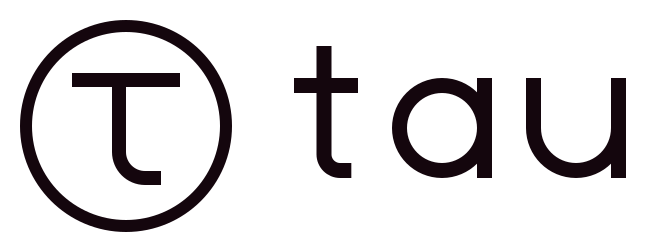

# tau brand

<picture>
  <source media="(prefers-color-scheme: dark)" srcset="tau-lockup-dark.svg">
  
</picture>

One mark for everything tau touches: the README, TauBar in the menu bar, the hub's screen, the necklace and the printed enclosures.

## Idea

**τ = 2π, one full turn.** The ring is the full turn: tau is always on, always coming back around. Inside it sits a lower-case τ drawn from the same line weight. In the hero, the mark stands on the stage from the poster: two neon triangles, vertical beams and a reflecting floor.

## Files

Every file is generated by [`render.py`](render.py) from one geometry, so the hero, icons and print files always agree. Edit `render.py` and run `python3 docs/brand/render.py`; don't edit the SVGs by hand.

| File | Use |
|---|---|
| [`tau-hero.svg`](tau-hero.svg) | README and site hero, 1280×560. Animated; stops under reduced motion |
| [`tau-mark.svg`](tau-mark.svg) | Neon mark on transparent. Dark backgrounds only, 48 px and up |
| [`tau-app-icon.svg`](tau-app-icon.svg) | App icon tile (TauBar, hub screen, social). 32 px and up |
| [`tau-mark-mono.svg`](tau-mark-mono.svg) | One colour, filled. Engraving, embossing, stickers, 3D print. 24 px and up |
| [`tau-coin.svg`](tau-coin.svg) | Solid disc with τ cut out. Favicon, menu bar template icon, pendant. Down to 16 px |
| [`tau-wordmark.svg`](tau-wordmark.svg) | "tau" alone, one colour |
| [`tau-lockup-dark.svg`](tau-lockup-dark.svg) · [`tau-lockup-light.svg`](tau-lockup-light.svg) | Mark + wordmark, for dark and light backgrounds |

`tau-mark-mono.svg`, `tau-coin.svg` and `tau-wordmark.svg` use `currentColor`: they render black as an `` and take the text colour when inlined.

## Colour

| | Name | Hex | Use |
|---|---|---|---|
|  | Void | `#05071A` | Backgrounds |
|  | Signal | `#FF2E63` | Triangles, ring start, alerts |
|  | Ember | `#FF7A3D` | Ring end, τ, beams |
|  | Flare | `#FFB25C` | Highlights, the thinking arc |
|  | Core | `#FFF4E0` | Neon core, text on dark |
|  | Ink | `#14060D` | One colour on light |

Neon (Signal → Ember ring, Ember τ with a Core line) only on Void or darker. On light backgrounds use Ink, flat.

## Rules

- **Clear space:** keep one τ line width (the stroke) free on every side at minimum; twice that where you can.
- **Don't** stretch, rotate, outline, add drop shadows, recolour outside the palette, or put the neon mark on a light or busy background.
- **Small sizes:** below 24 px use the coin; below 48 px don't use the neon glow.

## Motion

The hero's motion is the vocabulary for every screen tau has (hub display, TauBar, site):

- **Breathing:** the light inside the ring pulses slowly (5 s) when tau is idle.
- **Thinking:** a comet arc with a bright head circles the ring (7 s, eased) while tau works.
- **Instrument rings:** the dial ticks turn very slowly in opposite directions (80 s / 120 s).

Motion always stops under `prefers-reduced-motion`.

## Terminal

The TUI (`tau tui`) draws the mark from the same geometry as `render.py` (the constants are
copied into `tau_tui/brand.py`), rasterised into half-block cells: each terminal cell holds two
square pixels (`▀` with the top pixel as foreground and the bottom pixel as background), so a
24-column mark is 12 rows and the 16-column phone mark is 8 rows. It is anti-aliased toward Void,
uses the palette only (Signal → Ember ring, Ember τ with a Core centre line) and, following the
small-size rule, has no glow. Below 20 rows the mark gives way to the wordmark line. The header
`τ` carries the motion vocabulary in one cell: it breathes (Ember ↔ Flare, 5 s) while the welcome
card is on screen and runs the comet (Ember → Flare → Core, 2 s) while tau works; it is static
otherwise and under `TEXTUAL_ANIMATIONS=none`. Under `TAU_TUI_ASCII=1` (terminals without the
block characters) the mark falls back to `#`, `^` and `_` in Ember only and every box border is
drawn in ASCII.

State colours for terminal UIs (TauBar and the hub screen reuse them): **ok / success = Flare**,
**error = Signal**, **rejected = Ember**, **running / pending = Core at 55 %**, **attention =
Flare**, notice = Ember. There is no green and no red: shapes double the colours (`●`/`○`,
`✓`/`✗`, `◆`).

## Physical objects

For the necklace, enclosures and the hub's case, use **`tau-mark-mono.svg`** or **`tau-coin.svg`**. Both are one filled compound path with even-odd holes (no strokes), so CAD tools and slicers can import them, scale them and extrude them directly.

| At this mark diameter | Ring line | τ line |
|---|---|---|
| 20 mm | 1.1 mm | 1.3 mm |
| 30 mm | 1.7 mm | 2.0 mm |
| 40 mm | 2.3 mm | 2.6 mm |

- With a 0.4 mm FDM nozzle, keep lines at 1.2 mm or more: the ring mark from about 22 mm, the coin from about 18 mm.
- Raised or recessed by 0.6–1.0 mm reads well on enclosures. A two-colour print (Ink body, Ember inlay) matches the palette.
- The pendant loop (bail) is not part of the mark; add it in CAD above the ring.
